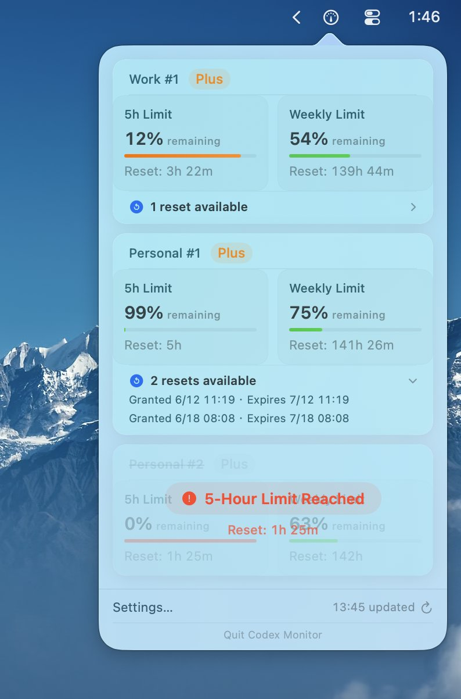

# CodexMonitor

[](https://www.apple.com/macos/) [](https://swift.org/) [](LICENSE) [](https://github.com/HanryYu/codex_multi_monitor/releases/latest) [](https://github.com/HanryYu/codex_multi_monitor/releases) [](https://github.com/HanryYu/codex_multi_monitor)

[English](README.md) | [中文](README_zh.md) | [日本語](README_ja.md)

A lightweight macOS menu bar app for monitoring Codex, Claude, Grok, and OpenCode Go quotas across multiple accounts.

<p align="center">
  
</p>

---

## Table of Contents

- [Features](#features)
- [Requirements](#requirements)
- [Installation](#installation)
- [Getting Your API Token](#getting-your-api-token)
- [Usage](#usage)
- [Status Colors](#status-colors)
- [Troubleshooting](#troubleshooting)
- [License](#license)

## Features

- **Real-Time Monitoring** — Track your Codex usage directly from the macOS menu bar
- **Multi-Account Support** — Monitor multiple Codex accounts with easy switching
- **Usage Visualization** — See 5-hour and weekly quota usage with reset countdowns or absolute reset times
- **Limit Status** — Visual overlay when 5-hour or weekly limit is reached, with reset countdown
- **Reset Credit Tracking** — Show available reset credits, grant times, and expiration times directly on each account card
- **Smart Notifications** — Receive usage warnings and scheduled recovery alerts at fixed 5-hour or weekly quota reset times
- **Weekly Cycle Activation (Beta)** — After weekly quota recovery, or when the weekly quota is detected at 100% remaining after a server-side reset, send one short Codex request to start the next weekly subscription cycle
- **Scheduled 5-Hour Refresh (Beta)** — Start a fresh 5-hour window at a daily time with an ultra-short, Low-reasoning request; advanced settings support per-account schedules and lightweight model selection
- **Auto Account Sync** — Automatically detect and add local Codex accounts on launch
- **Claude Monitoring** — Import local Claude OAuth credentials, refresh rotated tokens, and show 5-hour/weekly limits
- **Grok Monitoring** — Read local Grok billing data or the shared weekly quota from a grok.com browser session
- **OpenCode Go Monitoring** — Show authoritative 5-hour, weekly, and monthly quotas from the official OpenCode usage API or signed-in dashboard
- **Provider-Aware UI** — Distinguish Codex, Claude, Grok, and OpenCode Go accounts with provider-specific forms
- **Codex Reset Radar** — Track community reset forecasts and confirmed future reset times from Codex Reset Observatory
- **Multi-Language** — English, 简体中文, 繁體中文, 日本語
- **Automatic Updates** — Check, download, and install new versions from GitHub Releases

> Weekly Cycle Activation requires Auto Account Sync to capture full Codex login bundles as accounts are switched, including with [cc-switch](https://github.com/HanryYu/cc-switch). Without Auto Account Sync, activation can only use the currently signed-in Codex account. The activation request is deduplicated per account and weekly reset key.

## Requirements

- macOS 15.0+
- Xcode 16+ (for building from source)
- Swift 6.0+

## Installation

### Homebrew (Recommended)

```bash
brew install --cask HanryYu/tap/codex-multi-monitor
```

Use the fully qualified tap token above. Homebrew's official cask repository
also has a separate `codexmonitor` cask, so `brew install --cask codexmonitor`
may install the wrong app.

To upgrade:
```bash
brew upgrade --cask HanryYu/tap/codex-multi-monitor
```

If you previously installed the old tap token:
```bash
brew uninstall --cask HanryYu/tap/codexmonitor
brew install --cask HanryYu/tap/codex-multi-monitor
```

### Download DMG

1. Go to [Releases](https://github.com/HanryYu/codex_multi_monitor/releases/latest)
2. Download the `CodexMonitor-x.x.x.dmg` file
3. Open the DMG and drag **CodexMonitor** to your **Applications** folder
4. Launch CodexMonitor — it will appear in your menu bar

Official release builds are Developer ID signed, notarized by Apple, and distributed as Universal Binary apps for Apple Silicon and Intel Macs.

### Build from Source

```bash
git clone https://github.com/HanryYu/codex_multi_monitor.git
cd codex_multi_monitor
make install
```

Or manually:

```bash
swift build -c release
cp -f .build/release/CodexMonitor /Applications/CodexMonitor.app/Contents/MacOS/
open /Applications/CodexMonitor.app
```

## Getting Your API Token

### Method 1: Auto Account Management (Recommended)

CodexMonitor can automatically detect and manage your Codex accounts. Simply launch the app — it will scan local auth data, import accounts, and handle token refresh and deduplication automatically.

> If you use [cc-switch](https://github.com/HanryYu/cc-switch) or rotate tokens manually, keep Auto Account Sync enabled so CodexMonitor can save each switched account's full login bundle for all-account Weekly Cycle Activation.

### Method 2: Browser Network Tab

1. Open [chatgpt.com/codex/cloud/settings/analytics](https://chatgpt.com/codex/cloud/settings/analytics) in your browser and **log in**
2. Open Developer Tools (`⌘⌥I` on Mac) → **Network** tab
3. The page will automatically load usage data — look for a request to `wham/usage`
4. Click the request → **Headers** → copy the `Authorization: Bearer ***` value
5. Paste the token (without `Bearer ` prefix) into CodexMonitor

### Method 3: Local Command

If you have [Codex CLI](https://github.com/openai/codex) installed, extract the token locally:

```bash
cat ~/.codex/auth.json | python3 -c "import sys,json; d=json.load(sys.stdin); print(d['tokens']['access_token'])"
```

Copy the output and paste it into CodexMonitor.

Treat access tokens and `~/.codex/auth.json` like passwords. Do not commit or share them.

### Claude, Grok, and OpenCode Go

Choose the agent type before adding an account. The account form changes its title, labels, placeholders, and credential instructions for the selected provider.

**Claude**

- Local import reads `~/.claude/.credentials.json` when available, otherwise `Claude Code-credentials` from macOS Keychain. Background access never opens a Keychain password dialog; if access requires permission, paste a token manually instead.
- Credential reads are cached and failed attempts are delayed. Concurrent refreshes share one operation rather than repeatedly accessing Keychain.
- Expiring access tokens are refreshed through Claude's OAuth token endpoint. Rotated credentials are written back without prompting; if writing fails, the app retains the new credentials in memory and retries later. A restart before successful write-back may require signing in to Claude Code again.
- Manual entry detects and labels **Cookie** and **OAuth Token** separately. OAuth accepts a Bearer token, a full `Authorization: Bearer ...` header, or Claude auth JSON and uses `https://api.anthropic.com/api/oauth/usage`.
- For web usage, paste the complete `Cookie` request header from a `claude.ai` usage request, `sessionKey=…`, or the raw `sk-ant-sid01-…` value. Cookie mode uses `https://claude.ai/api/organizations/{organizationID}/usage`; it does not use OAuth refresh or read CLI credentials.
- Organization selection uses the optional Organization ID (or full usage request URL), then the Cookie's `lastActiveOrg`, then the only available organization. Multiple organizations without a clear selection require an explicit ID. This setting is saved per account, including backups and cloud sync.
- Both modes show the available 5-hour and weekly windows. Expired sessions, website access challenges, rate limits, and missing quota data produce distinct errors; a missing quota is never presented as 0%. Website endpoints are undocumented and may change.
- Usage requests share a five-minute cache. HTTP 429 responses pause requests for at least 15 minutes, honor longer `Retry-After` values, and increase the cooldown after repeated limits. Restarting the app does not reset a saved cooldown. During a cooldown, a snapshot up to 30 minutes old remains visible with its fetch time; otherwise the app shows when it can retry. A usage-query rate limit does not by itself establish that the account's quota is exhausted.

**Grok**

- Local import reads `~/.grok/auth.json`; expired OIDC credentials are refreshed and written back atomically.
- Manual CLI mode accepts a Grok Bearer token or the complete local auth JSON.
- To use the same shared weekly quota shown on `https://grok.com/?_s=usage`, open Developer Tools → Network, select `GetGrokCreditsConfig`, and copy its complete `Cookie` request header into the Grok credential field.
- Web billing accepts both raw Protobuf and gRPC-Web responses, including RPC status trailers. Transient failures retry once; expired credentials and access denials are reported directly.
- When CLI credits omit the percentage, the same token can read web billing or a separate monthly budget. Unavailable usage stays unknown rather than 0%.
- Automatic credential recovery requires a matching local CLI account; it never replaces a web Cookie with a different local login. If local refresh credentials are missing, sign in again or update the saved token.

**OpenCode Go**

- Manually add an OpenCode Go account and paste its API key (`sk-…` or `Bearer sk-…`). CodexMonitor reads the official `GET https://opencode.ai/zen/go/v1/usage` endpoint; no Workspace ID is needed.
- For a Console session, paste `__Host-console_session=…` or the full Cookie header from a signed-in `opencode.ai/console` request. The app discovers workspaces via `/console/api/orgs` and reads `/console/api/go/status` with `x-org-id`. The optional Workspace ID accepts `org_…`, `wrk_…`, `wk_…`, or a full Console URL. Legacy `auth` / `__Host-auth` cookies still have a fallback, but migrated accounts may require a fresh Console cookie; an old `auth` cookie alone is not sufficient.
- The [current Go rules](https://opencode.ai/docs/go/#usage-limits) apply model-specific quota multipliers. The 5-hour and weekly limits correspond to 20% and 50% of the monthly allowance. All three windows use the server's weighted quota and reset times; local token costs are never treated as remaining subscription quota.
- A failed refresh can show the same account's last successful server result for up to 30 minutes, labeled `Cached`. Changing credentials or workspace prevents reuse of another result.

Tokens and browser cookies grant account access. They are stored using CodexMonitor's encrypted token storage; do not share them or include them in bug reports.

## Usage

1. Launch **CodexMonitor** from your Applications folder
2. Click the menu bar icon to see your accounts
3. Accounts are auto-detected on launch — or click **+** to add manually
4. Choose a refresh interval in Settings; the default is 5 minutes
5. Enable **Weekly Quota Cycle** in Settings if you want CodexMonitor to send the one-time activation request after weekly quota recovery or a 100% weekly reset
6. Expand the reset-credit row on an account card to inspect grant and expiration times

### Codex Reset Radar

The compact Radar card shows the current 24-hour community forecast. When Codex Reset Observatory reports a confirmed future reset, the menu changes to **Next Reset Confirmed**, shows `100%`, and displays the next reset using the Relative or Absolute time format selected in Settings. Click the card, or hover briefly, to open the detail panel with the original signal, 24/48-hour outlook, local and source times, data-health warnings, refresh action, and source links.

Codex Reset Observatory is an independent community project and is not affiliated with OpenAI. Its global reset signals are separate from the authoritative personal quota windows shown on each account card.

## Status Colors

| Color | Meaning |
|-------|---------|
| 🟢 Green | > 50% quota remaining |
| 🟡 Yellow | 20-50% quota remaining |
| 🔴 Red | < 20% quota remaining |

The Reset Radar uses semantic status colors: blue for a confirmed future reset, green for an observed completed reset, orange for delayed data, and red for a failed refresh.

When a limit is reached (5-hour or weekly), the status area shows a "Limit Reached" overlay with the estimated reset time.
If recovery notifications are enabled, CodexMonitor schedules a system notification for that reset time instead of waiting for the next usage refresh.

Available reset credits appear below the quota cards. Expanding the row shows when each credit was granted and when it expires.

## Troubleshooting

**Menu bar icon not showing?**
- Check Activity Monitor — the app may already be running. Force quit and relaunch.

**"No accounts found" on first launch?**
- Make sure you've used Codex locally at least once, or add your token manually via the **+** button.

**Weekly Cycle Activation did not run?**
- Confirm **Weekly Quota Cycle** and **Auto Account Sync** are enabled, the Codex CLI is installed, and the account has a saved full Codex login bundle. CodexMonitor deduplicates activation requests and also skips repeat runs within five minutes for the same account.

**DMG won't open / "unidentified developer"?**
- Download the latest notarized DMG from the official [Releases](https://github.com/HanryYu/codex_multi_monitor/releases/latest) page and reinstall it.

## License

[GPLv3](LICENSE) — © 2026 Ryan Hansen
